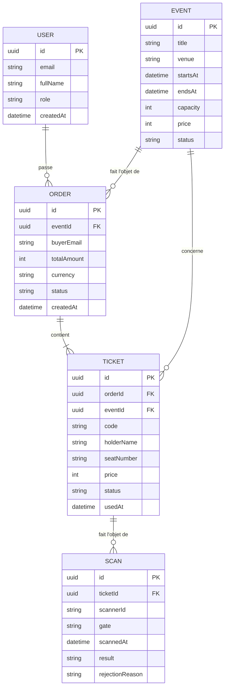

# Orbitale — Modèle de ressources (Livrable S1)

**Projet :** API RESTful de billetterie en ligne et de contrôle d'accès *Orbitale*  
**Module :** M2 Web Services — Séance 1 : Fondamentaux REST  
**Binôme :** NOM Prénom — NOM Prénom *(à compléter)*  
**Date :** 20 novembre 2026  
**Objectif architectural :** Niveau 2 de maturité de Richardson (avec prémisses niveau 3)  

---

## 1. Ressources métier

| Ressource | Description en une phrase | Attributs principaux | Qui la crée ? | Qui la lit ? |
| :--- | :--- | :--- | :--- | :--- |
| **Événement** (`/v1/events`) | Représente un spectacle, concert ou manifestation culturelle ouvert à la billetterie. | `id`, `title`, `description`, `venue`, `startsAt`, `endsAt`, `capacity`, `remaining` *(calculé)*, `price` (centimes), `currency`, `status` (`draft`, `published`, `cancelled`) | Administrateur / Organisateur | Grand public (web/mobile), Organisateur |
| **Utilisateur** (`/v1/users`) | Représente un compte client acheteur ou un opérateur de borne habilité. | `id`, `email`, `fullName`, `role` (`customer`, `operator`, `admin`), `createdAt` | Client lors de l'inscription / Admin | Client (son profil), Admin |
| **Commande** (`/v1/orders`) | Regroupe un panier d'achat de billets validé par un utilisateur avec son montant global et son état de paiement. | `id`, `eventId`, `buyerEmail`, `quantity` *(à la création)*, `totalAmount` *(centimes, calculé)*, `currency`, `status` (`pending`, `paid`, `cancelled`), `tickets`, `createdAt` | Client acheteur | Client acheteur, Comptabilité / Admin |
| **Billet** (`/v1/tickets`) | Titre d'accès nominatif unique conférant le droit d'entrée à un événement spécifique. | `id`, `orderId`, `eventId`, `code` (`ORB-` + 12 hex majuscules, imprimé dans le QR code), `holderName`, `seatNumber`, `price`, `status` (`valid`, `used`, `cancelled`), `usedAt` | Système (généré lors de la validation d'une commande payée) | Client acheteur, Application mobile, Borne de contrôle |
| **Scan** (`/v1/scans`) | Événement d'horodatage et de validation d'un billet lors d'un passage physique à une porte d'accès. | `id`, `ticketId`, `scannerId` *(identifiant de la borne)*, `gate`, `scannedAt`, `result` (`granted`, `denied`), `rejectionReason` (`already_used`, `invalid_ticket`, `cancelled`) | Borne d'accès à l'entrée de la salle | Organisateur (jauge en direct), Superviseur de sécurité |

> [!NOTE]
> **Représentation vs Schéma de base de données :**  
> Conformément aux principes REST, le champ `remaining` (places restantes) n'est pas une colonne de base : il est dynamiquement calculé (`capacity` - nombre de billets vendus). De même, `totalAmount` est calculé par le serveur (`quantity` × `price`). Les données sensibles (mots de passe, secrets de signature des QR codes) ne figurent jamais dans les représentations exposées : seul le `code` public du billet est renvoyé.

---

## 2. Relations et cardinalités

### Description des liens :
- **Utilisateur & Commande** : Un utilisateur passe `0..*` commandes ; une commande appartient obligatoirement à `1` utilisateur, identifié par `buyerEmail` (`USER ||--o{ ORDER`).
- **Événement & Commande** : Une commande porte sur `1` seul événement (`eventId`) ; un événement fait l'objet de `0..*` commandes (`EVENT ||--o{ ORDER`).
- **Commande & Billet** : Une commande regroupe `1..*` billets ; chaque billet est rattaché à exactement `1` commande (`ORDER ||--|{ TICKET`).
- **Événement & Billet** : Un événement propose `0..*` billets émis ; un billet correspond à `1` seul événement (`EVENT ||--o{ TICKET`).
- **Billet & Scan** : Un billet peut être scanné `0..*` fois (premier scan valide, ou réessais / scans refusés pour fraude) ; un scan référence `1` billet unique (`TICKET ||--o{ SCAN`).
- **Borne & Scan** : Une borne n'est pas un utilisateur : c'est un équipement identifié par `scannerId`, qui enregistre `0..*` scans. Elle n'est pas modélisée comme une ressource à part entière à ce stade.

### Diagramme Entité-Relation (Mermaid)

---

## 3. Endpoints de l'API Orbitale

Toutes les URI sont versionnées (`/v1/`), emploient des noms au pluriel et ne contiennent aucun verbe d'action. Les sous-ressources expriment l'appartenance (`/v1/orders/{id}/tickets`).

| Méthode | URI | Rôle | Statut succès | Erreurs possibles | Justification des codes |
| :--- | :--- | :--- | :--- | :--- | :--- |
| **GET** | `/v1/events` | Lister les événements (avec filtres : `venue`, `date`, `status`, pagination `page`, `per_page`) | `200 OK` | `400 Bad Request` `422 Unprocessable Content` | Renvoie `422` si un paramètre de filtre est syntaxiquement valide mais sémantiquement hors limites (ex: date de fin antérieure à la date de début). |
| **POST** | `/v1/events` | Créer un nouvel événement | `201 Created` `+ Location: /v1/events/{id}` | `400 Bad Request` `401 Unauthorized` `403 Forbidden` `422 Unprocessable Content` | Renvoie `201` avec l'en-tête `Location`. `403` si l'utilisateur n'a pas le rôle organisateur/admin. `422` si la capacité est <= 0. |
| **GET** | `/v1/events/{id}` | Obtenir les détails d'un événement | `200 OK` | `404 Not Found` | `404` si l'identifiant n'existe pas. Supporte le cache conditionnel via `ETag` et `304 Not Modified`. |
| **PATCH** | `/v1/events/{id}` | Modifier partiellement un événement (titre, dates, statut) | `200 OK` | `400 Bad Request` `404 Not Found` `409 Conflict` `422 Unprocessable Content` | `409 Conflict` si on tente de réduire la capacité en dessous du nombre de billets déjà vendus. |
| **DELETE** | `/v1/events/{id}` | Supprimer un événement | `204 No Content` | `401 Unauthorized` `403 Forbidden` `404 Not Found` `409 Conflict` | `204` sans corps en cas de succès. `409 Conflict` si des billets ont déjà été vendus (l'événement doit alors être annulé par PATCH et non supprimé). |
| **POST** | `/v1/orders` | Créer une commande de billets | `201 Created` `+ Location: /v1/orders/{id}` | `400 Bad Request` `401 Unauthorized` `409 Conflict` `422 Unprocessable Content` | `409 Conflict` si l'événement est complet (*Sold Out*). `422` (et non `404`) si l'`eventId` du corps n'existe pas : l'URI `/v1/orders` existe bien. Idempotence via `Idempotency-Key` à confirmer (voir questions ouvertes). |
| **GET** | `/v1/orders/{id}` | Consulter une commande et son statut | `200 OK` | `401 Unauthorized` `403 Forbidden` `404 Not Found` | `403` si le client tente d'accéder à la commande d'un autre utilisateur. |
| **PATCH** | `/v1/orders/{id}` | Mettre à jour l'état de la commande (ex: annulation) | `200 OK` | `400 Bad Request` `404 Not Found` `409 Conflict` | Permet d'annuler une commande en envoyant `{"status": "cancelled"}` sans verbe dans l'URI. `409` si la commande n'est plus annulable (déjà annulée, événement passé). |
| **GET** | `/v1/orders/{id}/tickets` | Lister les billets rattachés à une commande (sous-ressource) | `200 OK` | `401 Unauthorized` `403 Forbidden` `404 Not Found` | Exprime la relation d'appartenance directe hiérarchique commande -> billets. |
| **GET** | `/v1/tickets/{id}` | Consulter un billet individuel (titre d'accès avec QR code) | `200 OK` | `401 Unauthorized` `403 Forbidden` `404 Not Found` | Ressource de premier niveau pour un accès direct par son identifiant global. |
| **POST** | `/v1/scans` | Enregistrer le contrôle d'accès d'un billet par une borne | `201 Created` `+ Location: /v1/scans/{id}` | `400 Bad Request` `401 Unauthorized` `403 Forbidden` `422 Unprocessable Content` | **Valide l'entrée physique**. Répond `201` même si l'accès est refusé, car la trace du scan est créée : un billet déjà composté, annulé ou inconnu donne `result: denied` avec `rejectionReason` (`already_used`, `cancelled`, `invalid_ticket`). Les erreurs HTTP sont réservées aux requêtes invalides (`422`) ou à une borne non autorisée (`403`). |
| **GET** | `/v1/scans` | Consulter l'historique des scans (filtres : `eventId`, `gate`, `result`) | `200 OK` | `401 Unauthorized` `403 Forbidden` | Utilisé par les organisateurs et la sécurité pour suivre la jauge en direct. |

---

## 4. Justification des choix de conception (Défense pour la soutenance)

### 1. Pourquoi avoir choisi `PATCH` plutôt que `PUT` pour modifier un événement ?
> **Justification :**  
> Selon la RFC 9110, `PUT` remplace intégralement la représentation : le client doit renvoyer tout l'état de l'événement, et un champ oublié est effacé ou remis à sa valeur par défaut. Il doit aussi connaître et renvoyer des champs qu'il ne gère pas.  
> `PATCH` (RFC 5789) applique une modification partielle : pour reporter l'heure de début ou clore les ventes, l'organisateur envoie seulement le champ concerné (`EventPatch`, `minProperties: 1`), sans risquer d'altérer la capacité ou la description.  
> Les mises à jour concurrentes perdues (*lost updates*) ne sont pas réglées par le choix de la méthode : elles se traitent avec l'`ETag` et l'en-tête `If-Match` (réponse `412 Precondition Failed` si la ressource a changé entre-temps).

### 2. Comment annule-t-on une commande sans verbe dans l'URI ?
> **Justification :**  
> L'emploi d'URI d'action comme `POST /orders/42/cancel` est un anti-pattern RPC qui viole le principe fondamental de l'interface uniforme REST, où l'URI identifie la ressource et la méthode HTTP porte l'intention.  
> Pour respecter le modèle REST, l'annulation d'une commande est traitée comme une transition d'état de la ressource. Le client envoie donc une requête `PATCH /v1/orders/42` contenant la mutation d'état : `{"status": "cancelled"}`. Si la commande n'est plus annulable (ex: événement déjà terminé), le serveur refuse la transition avec un code `409 Conflict`. Le schéma `OrderPatch` n'accepte que `status: cancelled` : le client ne peut pas se déclarer lui-même `paid`.

### 3. Quelle ressource expose-t-on aux bornes qui scannent les billets ?
> **Justification :**  
> Plutôt que de créer un endpoint de type procédure `POST /validateTicket` ou de modifier directement le billet via `PATCH /v1/tickets/{id}`, nous matérialisons l'action physique de contrôle d'accès sous forme d'une ressource d'événement : `POST /v1/scans`.  
> Ce choix apporte trois bénéfices architecturaux déterminants :
> 1. **Traçabilité et audit :** Chaque passage engendre une ressource `Scan` persistée (contenant l'horodatage exact, l'identifiant de la borne, la porte d'entrée et le résultat).
> 2. **Détection de fraude :** Une tentative de réutilisation d'un même billet est enregistrée et visible immédiatement par la sécurité.
> 3. **Indépendance des responsabilités :** La borne dispose de droits restreints en écriture uniquement sur les scans, sans avoir accès direct aux mutations administratives des billets.
>
> **Pourquoi `/v1/scans` à plat et pas `/v1/tickets/{id}/scans` ?** Un scan appartient bien à un billet, mais la borne ne connaît pas l'identifiant interne du billet au moment du passage : elle lit le QR code. Une collection de premier niveau évite à la borne de résoudre le billet avant de poster, et permet à la sécurité de filtrer tous les scans d'une porte (`GET /v1/scans?gate=...`).

---

## 5. Questions ouvertes pour Camille

Lors de la revue d'architecture avec Camille, les points de cadrage suivants doivent être arbitrés :

1. **Stratégie hors-ligne pour les bornes d'entrée :**  
   Les réseaux 4G/Wi-Fi des salles de spectacle et festivals sont fréquemment saturés ou instables. Devons-nous embarquer une clé publique dans les bornes pour vérifier localement un JWT signé présent dans le QR code du billet en cas de coupure réseau, avec synchronisation asynchrone des `POST /v1/scans` lors du retour en ligne ?
2. **Durée de rétention du panier (*Hold*) et concurrence :**  
   Lors de l'achat d'un billet, quelle durée de réservation temporaire accorde-t-on à l'utilisateur avant de libérer la place (ex: 15 minutes) ? Cela nécessite-t-il une sous-ressource de pré-réservation ou un statut temporaire `pending` sur la commande avec un mécanisme de libération automatique (TTL) ?
3. **Politique d'idempotence des paiements :**  
   Confirme-t-on l'exigence d'un en-tête `Idempotency-Key: <UUID>` obligatoire pour toute création de commande `POST /v1/orders` afin de garantir qu'une déconnexion réseau mobile ne provoque jamais un double prélèvement bancaire pour le client ?
